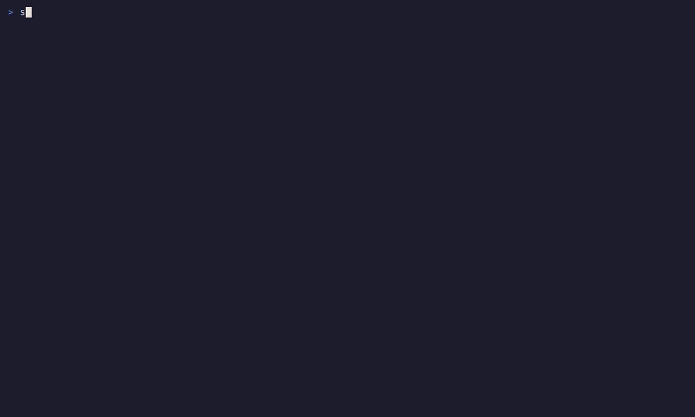

<div align="center">

# squish

**Squish your images down to size, in your terminal.**

A friendly app for compressing photos and graphics, with live size estimates and
a tiny hydraulic press.

[](https://github.com/jamaalsawyerd/squish/actions/workflows/ci.yml)
[](https://github.com/jamaalsawyerd/squish/releases/latest)
[](LICENSE)



[Install](#install) · [Quick start](#quick-start) · [Command line](#command-line-reference) · [Keys](#keys) · [Formats](#formats)

</div>

## Why squish?

- **Small files that still look right.** One Squeeze setting works the same
  across formats, tuned on real camera photos.
- **See it before you commit.** Watch the estimated size update as you change
  settings, then press `o` to open the full result in your own image viewer.
- **Safe by default.** Originals are never touched, a file that wouldn't get
  smaller is left alone, and photos stay the right way up.
- **Fast.** 22 camera originals took 13 seconds on a 16-thread machine.
- **One small binary.** No ImageMagick, no libvips, no setup.
- **Actually fun.** There's a press, confetti, achievements, and your savings
  measured in floppy disks.

## Install

### Download a binary

Grab the archive for your system from the
[latest release](https://github.com/jamaalsawyerd/squish/releases/latest),
unpack it, and put `squish` somewhere on your `PATH`. There are builds for:

| System | Archive |
|---|---|
| Linux (Intel/AMD or ARM) | `squish_*_linux_amd64.tar.gz`, `squish_*_linux_arm64.tar.gz` |
| macOS (Intel or Apple silicon) | `squish_*_darwin_amd64.tar.gz`, `squish_*_darwin_arm64.tar.gz` |
| Windows (Intel/AMD or ARM) | `squish_*_windows_amd64.zip`, `squish_*_windows_arm64.zip` |

On macOS, if you see "cannot be opened because the developer cannot be
verified", run `xattr -d com.apple.quarantine ./squish` once.

### With Go

If you have Go 1.26 or newer:

```sh
go install -tags nodynamic github.com/jamaalsawyerd/squish/cmd/squish@latest
```

The `nodynamic` tag builds the image codecs into the binary, so there's nothing
else to install.

### From source

```sh
git clone https://github.com/jamaalsawyerd/squish.git
cd squish
make build    # Creates bin/squish
```

Check it worked with `squish --version`.

## Quick start

Open the app in any folder:

```sh
squish
```

Then:

1. **Pick** your images. Press `space` to select a file, or `space` on a folder
   to select every image inside it, subfolders included. You can also drag
   files into the terminal window.
2. **Tune** the settings with the arrow keys. The estimated size updates as you
   go, and `o` opens the real result in your image viewer.
3. Press `enter` to **squish!** Your new files are saved beside the originals as
   `name-squished.jpg`.

You can also start with files or folders already loaded:

```sh
squish ~/Pictures/holiday
squish -r ~/Pictures          # include subfolders
squish IMG_0042.jpg IMG_0043.jpg
```

### In scripts

Add `--no-tui` to skip the app and print one line per file instead. squish does
this by itself when its output is piped.

```sh
# Resize for the web, keeping the originals
squish --no-tui --max-size 2000 --out web/ photos/

# Compress a whole folder tree, subfolders included
squish --no-tui -r ~/Pictures/2026

# Let squish choose the best format for each image
squish --no-tui --format auto *.png

# Squeeze as hard as possible
squish --no-tui --format avif --preset small photos/

# Replace the originals, but only where the new file is smaller
squish --no-tui --in-place photos/
```

The exit code is non-zero if any file failed or the run was stopped early.

## Command line reference

```
squish [files or folders...] [flags]
```

With no files, squish opens the app in the current folder. Folders are searched
for JPEG, PNG, WebP, AVIF and GIF files. Hidden files and squish's own
`-squished` output are skipped.

### Flags

| Flag | Short | Default | What it does |
|---|---|---|---|
| `--format` | `-f` | `same` | Output format: `same`, `auto`, `jpeg`, `png`, `webp` or `avif`. See [Formats](#formats). |
| `--preset` | `-p` | `balanced` | How hard to squeeze: `high` (best quality), `balanced` or `small`. |
| `--level` | `-l` | | Squeeze level from 1 (gentle) to 10 (hard), instead of a preset. `high` is 3, `balanced` is 5, `small` is 7. |
| `--quality` | `-q` | | Exact encoder quality from 1 to 100. Overrides `--preset` and `--level`. |
| `--max-size` | `-s` | | Shrink images so the longest side fits this many pixels. Smaller images are left at their size. |
| `--out` | `-o` | | Write output to this folder instead of beside each original. |
| `--in-place` | | off | Replace originals, but only with smaller files. Can't be used with `--out`. |
| `--keep-metadata` | `-m` | off | Keep EXIF data, including camera details and GPS location. |
| `--recursive` | `-r` | off | Include subfolders of any folder you pass. |
| `--workers` | `-w` | your CPU count, up to 8 | How many files to compress at once. |
| `--background` | | `#ffffff` | Color to put behind transparent areas when the format has no transparency, such as JPEG. |
| `--no-tui` | | off | Print progress as text instead of opening the app. |
| `--no-anim` | | off | Turn off animations in the app. |
| `--version` | `-v` | | Print the version and exit. |
| `--help` | `-h` | | Show help and exit. |

### Commands

| Command | What it does |
|---|---|
| `squish help` | Show help, the same as `--help`. |
| `squish completion bash` | Print a tab-completion script for bash. Also `zsh`, `fish` and `powershell`. |
| `squish man` | Print a man page. |

To turn on tab completion, add one of these to your shell's startup file:

```sh
source <(squish completion bash)          # ~/.bashrc
source <(squish completion zsh)           # ~/.zshrc
squish completion fish | source           # ~/.config/fish/config.fish
```

To install the man page: `squish man > /usr/local/share/man/man1/squish.1`.

## Keys

### Pick

| Key | What it does |
|---|---|
| `↑` `↓` or `k` `j` | Move up and down |
| `space` | Select a file. On a folder, select every image inside it and its subfolders. Press again to unselect them. |
| `a` | Select all images in this folder |
| `A` | Select all images in this folder and every subfolder |
| `enter` | Open a folder, or go to Tune with your selection (or the file under the cursor, if nothing is selected) |
| `backspace` or `←` | Go up a folder |
| `g` | Type a path to go to, or files to add |
| `.` | Show or hide hidden files |
| `tab` | Go to Tune with your selection |
| `q` | Quit |

Folders show how many images inside them are selected. Selecting a folder skips
hidden folders and files squish has already made, just like `--recursive`.

### Tune

| Key | What it does |
|---|---|
| `↑` `↓` | Choose a setting: Format, Squeeze, Size, Metadata or Save to |
| `←` `→` | Change it |
| `o` | Open the full result in your image viewer |
| `[` `]` | Previous or next file |
| `enter` | Squish! |
| `esc` | Back to Pick |
| `q` | Quit |

Press `o` and squish compresses the whole image with your current settings,
saves it to a temporary file and opens it in your default image viewer. Nothing
is written beside your originals, and temporary files are deleted when you quit.
Over SSH, or with no viewer to open, squish shows the file's path instead.

### Squishing

| Key | What it does |
|---|---|
| `esc` or `q` | Stop after the files in progress |

### Results

| Key | What it does |
|---|---|
| `↑` `↓` | Choose a file |
| `o` | Open the saved file in your image viewer |
| `r` | Try new settings on the same files |
| `n` | Start a new batch |
| `q` | Quit |

## How much does it save?

These are 22 real camera originals from NASA's image library, 230 MB in total,
straight from Canon, Nikon and Hasselblad cameras:

| Setting | Output | Smaller by | Time |
|---|---:|---:|---:|
| JPEG, High | 63 MB | 72% | 14 s |
| **JPEG, Balanced** (the default) | **41 MB** | **82%** | **13 s** |
| JPEG, Small | 30 MB | 87% | 12 s |
| WebP, Balanced | 60 MB | 74% | 29 s |
| AVIF, Balanced | 27 MB | 88% | 134 s |

Your results will vary. Sharp, detailed or low-light photos save less, and images
that were already compressed save much less.

## Formats

squish reads JPEG, PNG, WebP, AVIF and GIF, and writes JPEG, PNG, WebP and AVIF.

| Format setting | What happens |
|---|---|
| **Same as input** (`same`) | Each file keeps its format. This is the default. |
| **Auto** (`auto`) | Photos become JPEG. Screenshots and graphics use lossless WebP or PNG, whichever is smaller. |
| **JPEG** (`jpeg`) | Great for photos, and works everywhere. Transparency is replaced by a background color. |
| **PNG** (`png`) | Uses a palette when that still looks good, and keeps full color when it doesn't. |
| **WebP** (`webp`) | Lossless for graphics, lossy for photos. |
| **AVIF** (`avif`) | The smallest files, but much slower, and needs over 1 GB of memory per photo. |

Not sure? Leave it on Same as input, or try Auto.

## Good to know

- Output goes beside each file as `name-squished.jpg`, or into the folder you
  choose. Existing files are never overwritten.
- `--in-place` replaces originals, but only when the new file is smaller.
- EXIF data is removed by default, which also removes any GPS location. Use
  `--keep-metadata` to keep it.
- Color profiles are kept where the format allows, except in AVIF, where squish
  warns you that colors may shift.
- Animated images are skipped for now, rather than being flattened to one frame.
- PNG has no lossless optimizer yet, so lossless savings are small. For bigger
  savings, try Format: Auto.
- Achievements and lifetime totals are saved in your user config folder, in
  `squish/stats.json`. Nothing leaves your machine.

## Contributing

Bug reports and pull requests are welcome. To work on squish you need Go 1.26 or
newer:

```sh
make build    # Build bin/squish
make test     # Run the tests with the race detector
make lint     # Run golangci-lint
make samples  # Download sample photos into samples/
make demo     # Re-record docs/demo.gif (needs VHS)
```

[docs/codecs.md](docs/codecs.md) explains why squish uses the libraries it does,
with the measurements behind each choice.

## Thanks

Built with [Bubble Tea](https://github.com/charmbracelet/bubbletea),
[Lip Gloss](https://github.com/charmbracelet/lipgloss),
[Bubbles](https://github.com/charmbracelet/bubbles),
[Harmonica](https://github.com/charmbracelet/harmonica) and
[Fang](https://github.com/charmbracelet/fang) from Charm. Image encoding and
decoding comes from the excellent libraries by
[gen2brain](https://github.com/gen2brain).

The photos in the demo are public domain images from the
[NASA Image and Video Library](https://images.nasa.gov/). This project is not
affiliated with or endorsed by NASA.

## License

[MIT](LICENSE)
